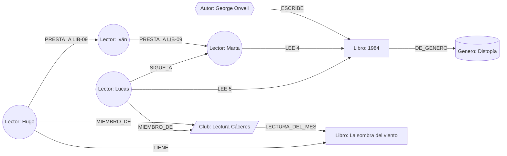

# Práctica 02 - Modelado de Grafos con Neo4j

Alejandro Murillo

Escenario: comunidad de intercambio de libros tipo Goodreads, la he llamado **PasaPágina**

Version de Neo4j: 5.27-aura (Enterprise), lo he hecho en Neo4j Aura desde la pestaña Query

## Como ejecutarlo

Con la base vacia (`MATCH (n) DETACH DELETE n;`) se pegan los scripts en el editor y se le da a Run en este orden:

1. `scripts/01-restricciones-indices.cypher`
2. `scripts/02-carga-datos.cypher` (tienen que salir 28 nodos y 62 relaciones)
3. `scripts/03-consultas-recorridos.cypher` (mejor de una en una y en orden porque la P6 cambia datos)
4. `scripts/04-backup.md` es la parte de copias y permisos

Si se hace en Neo4j Desktop hay que activar en ajustes "Enable multi statement query editor" para poder pegar varias cosas a la vez.

---

## 1. Definir el problema y los accesos

### 1.1 Escenario y usuarios

Escenario: PasaPágina es como Goodreads, apuntas los libros que lees, les pones nota de 1 a 5, sigues a otra gente y te puedes meter en clubes de lectura. Lo que he añadido es que tambien sirve para **prestarse libros fisicos**, cada uno marca los libros que tiene en casa y se guardan los prestamos, asi se puede ver por quien ha ido pasando un libro.

Usuarios:
- **Lector**: apunta lo que lee, pone notas, sigue a gente, se mete en clubes y presta o pide libros
- **Club de lectura**: elige el libro del mes y tiene sus miembros
- **Analista**: mira que generos gustan mas y que libros se prestan mas
- **Motor de recomendaciones**: te recomienda libros segun la gente que tiene gustos parecidos a ti, la gente que sigues y tus clubes, y ademas te dice quien te lo puede dejar

### 1.2 Seis preguntas que tiene que responder la base de datos

1. Que libros tiene un autor (ej. George Orwell) con su año, paginas, genero y nota media
2. Que libros me recomiendan los lectores que tienen gustos parecidos a los mios (los que han puntuado alto lo mismo que yo)
3. Que libros le gustan a la gente que sigo y a mis clubes que yo no he leido, y quien me los puede prestar
4. Por que manos ha pasado un libro (cadena de prestamo)
5. Si quiero un libro, quien lo tiene y cual es el camino mas corto de contactos hasta esa persona (shortestPath)
6. Como guardo que he terminado un libro con su nota o un prestamo nuevo sin que se duplique (MERGE y SET)

### 1.3 Datos con mas lectura y escritura

Lecturas (lo que mas se usa, como un 90%): la pantalla de inicio con las recomendaciones, la ficha de un libro o autor con la nota media, el buscador por titulo o autor y ver quien tiene un libro.

Escrituras (un 10% mas o menos): marcar un libro como leido y ponerle nota, apuntar un prestamo o devolverlo, seguir a alguien o meterte en un club.

### 1.4 Seguridad, privacidad, disponibilidad y crecimiento

- **Seguridad**: la conexion va cifrada (`neo4j+s://`) y la app usa un usuario que solo puede leer y que no puede ver los emails. El admin es otro usuario aparte.
- **Privacidad (RGPD)**: de cada lector solo guardo nombre, ciudad y email. Hay un campo `perfil_privado` para que no se vea lo que lees. Si alguien se da de baja se hace `DETACH DELETE` y se borran sus relaciones pero los libros y autores se quedan. Si esa persona esta en medio de una cadena de prestamos de otros es mejor anonimizarla para no romperla.
- **Disponibilidad**: en una app de verdad pondria un cluster de Neo4j con varias copias para que si se cae un servidor siga funcionando, y backups todos los dias (Aura ya los hace solo).
- **Crecimiento**: lo que mas crece son las lecturas y los prestamos. Las consultas siempre empiezan en un lector o un autor concreto y no en un genero, que puede tener miles de libros.

---

## 2. Diseñar el grafo de nodos y relaciones



### 2.1 Etiquetas de nodos y tipos de relaciones

Nodos:
- `:Lector` → id, nombre, email, ciudad, perfil_privado
- `:Libro` → id, titulo, anio, paginas, veces_prestado
- `:Autor` → id, nombre, pais
- `:Genero` → id, nombre
- `:Club` → id, nombre, online, ciudad

Obligatorios son el id y el nombre o titulo, sin eso el nodo no sirve.

Relaciones:
```
(:Autor)-[:ESCRIBE]->(:Libro)
(:Libro)-[:DE_GENERO]->(:Genero)
(:Lector)-[:LEE {estado: "leido", puntuacion: 5}]->(:Libro)
(:Lector)-[:TIENE {estado_copia: "bueno"}]->(:Libro)
(:Lector)-[:SIGUE_A {desde: date("2024-02-01")}]->(:Lector)
(:Lector)-[:PRESTA_A {libro: "LIB-09", fecha: date("2026-02-01"), devuelto: false}]->(:Lector)
(:Lector)-[:MIEMBRO_DE {desde: date("2024-10-01")}]->(:Club)
(:Club)-[:LECTURA_DEL_MES {mes: "2026-10"}]->(:Libro)
```

### 2.2 Ejemplo en Cypher

```cypher
MERGE (a:Autor {id: "AUT-03"}) SET a.nombre = "George Orwell", a.pais = "GB"
MERGE (b:Libro {id: "LIB-04"}) SET b.titulo = "1984", b.anio = 1949, b.paginas = 352
MERGE (g:Genero {id: "GEN-02"}) SET g.nombre = "Distopía"
MERGE (l:Lector {id: "LEC-01"}) SET l.nombre = "Lucas", l.ciudad = "Cáceres"
MERGE (a)-[:ESCRIBE]->(b)
MERGE (b)-[:DE_GENERO]->(g)
MERGE (l)-[r:LEE]->(b) SET r.estado = "leido", r.puntuacion = 5;
```

### 2.3 Por que grafo y no SQL

Para recomendar libros por gente con gustos parecidos en SQL tienes que cruzar la tabla de lecturas consigo misma un monton de veces (yo → mis libros → otros lectores → sus libros) y meter un `NOT EXISTS`, y con millones de lecturas eso va lento. En Neo4j vas saltando por las flechas desde tu nodo y solo mira lo que tienes alrededor. Las cadenas de prestamo encima no sabes cuantos saltos tienen, en SQL necesitas una consulta recursiva y aqui es poner `PRESTA_A*1..5`.

Autor, Genero y Club los he puesto como nodos y no como texto dentro del libro porque los comparten muchos libros o lectores. Asi puedo sacar "otros libros del mismo autor" y no pasa que tengas "G. G. Márquez" y "García Márquez" como si fueran dos distintos.

### 2.4 Identificadores y propiedades en las relaciones

- Ids que se entienden con prefijo (`LEC-01`, `LIB-04`, `AUT-03`...) y con restriccion de que sean unicos. En una app real el del libro seria el ISBN. El id interno de Neo4j no lo uso porque lo puede reutilizar.
- La nota va en la relacion `LEE` porque no es del lector ni del libro, es de ese lector con ese libro. Asi no hace falta tabla intermedia.
- El prestamo es una relacion `PRESTA_A` entre dos lectores con el id del libro dentro, asi se encadenan facil. Lo pense como nodo `:Prestamo` pero la cadena salia el doble de larga.

### 2.5 Limites del modelo

- **Supernodos**: un genero como "Fantasía" puede tener cientos de miles de libros, por eso las consultas empiezan en un lector o autor y el genero solo se usa para filtrar.
- **Saltos acotados**: siempre pongo limite (`*1..5`, `*..6`), nunca `*` solo.
- No conviene hacer `MATCH (n) RETURN n` en produccion, ni sumar cosas de todo el grafo, ni meter portadas o PDFs dentro (solo la url).

---

## 3. Restricciones, indices y carga

### 3.1 Restricciones de unicidad

Para que no se puedan meter dos nodos con el mismo id, y de paso crean un indice:

```cypher
CREATE CONSTRAINT c_lector_id IF NOT EXISTS FOR (l:Lector) REQUIRE l.id IS UNIQUE;
CREATE CONSTRAINT c_libro_id  IF NOT EXISTS FOR (b:Libro)  REQUIRE b.id IS UNIQUE;
CREATE CONSTRAINT c_autor_id  IF NOT EXISTS FOR (a:Autor)  REQUIRE a.id IS UNIQUE;
CREATE CONSTRAINT c_genero_id IF NOT EXISTS FOR (g:Genero) REQUIRE g.id IS UNIQUE;
CREATE CONSTRAINT c_club_id   IF NOT EXISTS FOR (c:Club)   REQUIRE c.id IS UNIQUE;
```

### 3.2 Indices secundarios

Para encontrar rapido el nodo por el que empieza la busqueda, porque en la app la gente busca por titulo o por autor y no por id:

```cypher
CREATE INDEX idx_libro_titulo   IF NOT EXISTS FOR (b:Libro) ON (b.titulo);
CREATE INDEX idx_autor_nombre   IF NOT EXISTS FOR (a:Autor) ON (a.nombre);
CREATE INDEX idx_libro_anio     IF NOT EXISTS FOR (b:Libro) ON (b.anio);
CREATE INDEX idx_prestamo_libro IF NOT EXISTS FOR ()-[p:PRESTA_A]-() ON (p.libro);
```

### 3.3 Carga con MERGE

El script entero esta en `scripts/02-carga-datos.cypher`: 4 generos, 6 autores, 10 libros, 6 lectores y 2 clubes (**28 nodos**) y **62 relaciones**. Los datos son inventados y los emails son `@ejemplo.test`.

Lo importante es que las relaciones **primero buscan los dos nodos con MATCH por el id y luego hacen el MERGE**. Esto lo aprendi a base de fallar, porque despues de cada `;` las variables se pierden y si vuelves a usar `(c1)` en otra sentencia Neo4j te crea un nodo vacio nuevo. Uso `UNWIND` para no repetir la misma linea mil veces:

```cypher
UNWIND [
  ["AUT-01","LIB-01"], ["AUT-01","LIB-02"], ["AUT-03","LIB-04"]
] AS f
MATCH (a:Autor {id: f[0]}), (b:Libro {id: f[1]})
MERGE (a)-[:ESCRIBE]->(b);
```

En los prestamos el id del libro va dentro del MERGE porque dos personas se pueden prestar varios libros:

```cypher
MERGE (a)-[p:PRESTA_A {libro: f.libro}]->(b)
SET p.fecha = date(f.fecha), p.devuelto = f.devuelto;
```

Lo he ejecutado dos veces y siguen saliendo 28 nodos y 62 relaciones, o sea que no duplica nada.

### 3.4 PROFILE

```cypher
PROFILE
MATCH (b:Libro {titulo: "1984"})
RETURN b.titulo, b.anio, b.paginas;
```

En el plan sale **NodeIndexSeek** con `RANGE INDEX b:Libro(titulo)` que es mi indice `idx_libro_titulo`. Devuelve 1 fila y solo hace **4 accesos** a la base de datos, va directo al libro. Si no estuviera el indice saldria `NodeByLabelScan` y miraria todos los libros uno a uno.

---

## 4. Consultas Cypher y caminos

### 4.1 Un salto: libros de un autor

```cypher
MATCH (a:Autor {nombre: "George Orwell"})-[:ESCRIBE]->(b:Libro)
OPTIONAL MATCH (b)-[:DE_GENERO]->(g:Genero)
OPTIONAL MATCH (:Lector)-[r:LEE]->(b)
RETURN b.titulo AS libro, b.anio AS anio, b.paginas AS paginas, g.nombre AS genero,
       round(avg(r.puntuacion), 1) AS nota_media, count(r) AS lectores
ORDER BY nota_media DESC;
```

Sale 1984 con un 4.7 (3 lectores) y Rebelión en la granja con un 4.0 (1 lector).

### 4.2 Recomendacion por afinidad

Busco a la gente que ha puesto 4 o 5 estrellas a los mismos libros que yo y me recomiendo lo que ellos han puntuado alto y yo no he leido. Cuantos mas libros en comun tengas con alguien mas peso tiene lo que te recomienda.

```cypher
MATCH (yo:Lector {id: "LEC-01"})-[r1:LEE]->(b:Libro)<-[r2:LEE]-(otro:Lector)
WHERE r1.puntuacion >= 4 AND r2.puntuacion >= 4
WITH yo, otro, count(b) AS libros_en_comun
MATCH (otro)-[r3:LEE]->(rec:Libro)
WHERE r3.puntuacion >= 4 AND NOT EXISTS { (yo)-[:LEE]->(rec) }
RETURN rec.titulo AS libro_recomendado, collect(otro.nombre) AS recomendado_por,
       sum(libros_en_comun) AS afinidad
ORDER BY afinidad DESC, libro_recomendado;
```

Marta tiene 2 libros en comun con Lucas asi que salen primero los suyos (La casa de los espíritus y Un mundo feliz) y luego 4 libros con afinidad 1 de Iván y Sara.

### 4.3 Recomendacion por la gente que sigo y mis clubes

```cypher
MATCH (yo:Lector {id: "LEC-01"})-[:SIGUE_A]->(amigo:Lector)-[r:LEE]->(b:Libro)
WHERE r.puntuacion >= 4 AND NOT EXISTS { (yo)-[:LEE]->(b) }
RETURN b.titulo AS libro, amigo.nombre AS lo_recomienda, r.puntuacion AS estrellas,
       EXISTS { (amigo)-[:TIENE]->(b) } AS te_lo_puede_prestar
ORDER BY estrellas DESC, libro;
```

```cypher
MATCH (yo:Lector {id: "LEC-01"})-[:MIEMBRO_DE]->(c:Club)-[m:LECTURA_DEL_MES]->(b:Libro)
WHERE NOT EXISTS { (yo)-[:LEE]->(b) }
OPTIONAL MATCH (c)<-[:MIEMBRO_DE]-(compi:Lector)-[:TIENE]->(b)
WHERE compi <> yo
RETURN c.nombre AS club, m.mes AS mes, b.titulo AS libro,
       collect(compi.nombre) AS te_lo_puede_prestar;
```

A Lucas le toca leer La sombra del viento en el club de Cáceres y Hugo, que es del club, lo tiene en casa. En el club online le toca El temor de un hombre sabio y lo tiene Sara.

### 4.4 Cadena de prestamo

Por que manos ha pasado La sombra del viento. Busco la cadena entera, o sea que al primero nadie se lo prestara y que el ultimo no se lo haya pasado a nadie:

```cypher
MATCH camino = (origen:Lector)-[:PRESTA_A*1..5]->(actual:Lector)
WHERE all(p IN relationships(camino) WHERE p.libro = "LIB-09")
  AND NOT EXISTS { (:Lector)-[:PRESTA_A {libro: "LIB-09"}]->(origen) }
  AND NOT EXISTS { (actual)-[:PRESTA_A {libro: "LIB-09"}]->(:Lector) }
RETURN [n IN nodes(camino) | n.nombre] AS cadena_de_prestamo,
       length(camino) AS num_prestamos, actual.nombre AS lo_tiene_ahora;
```

Sale Hugo → Iván → Marta, 2 prestamos y ahora lo tiene Marta.

### 4.5 Camino mas corto (shortestPath)

Carla quiere La sombra del viento, quien lo tiene y cual es el camino mas corto de contactos hasta esa persona. Cuento como contacto seguirse o haberse prestado algo, da igual la direccion.

```cypher
MATCH (yo:Lector {id: "LEC-06"})
MATCH (:Libro {id: "LIB-09"})<-[:TIENE]-(dueno:Lector)
MATCH camino = shortestPath((yo)-[:SIGUE_A|PRESTA_A*..6]-(dueno))
RETURN dueno.nombre AS lo_tiene, [n IN nodes(camino) | n.nombre] AS cadena, length(camino) AS saltos;
```

Sale Carla → Sara → Hugo, 2 saltos. Sara le presto un libro a Carla y sigue a Hugo asi que hace de puente. (Sale un aviso de "Cartesian product" pero no es un error, es porque busca dos nodos que no estan unidos).

### 4.6 MERGE + SET

Lucas termina El temor de un hombre sabio y le pone un 5. Si no estaba la relacion se crea y si estaba se actualiza, aunque lo lances dos veces solo hay una:

```cypher
MATCH (yo:Lector {id: "LEC-01"}), (b:Libro {id: "LIB-08"})
MERGE (yo)-[r:LEE]->(b)
ON CREATE SET r.fecha_inicio = date()
SET r.estado = "leido", r.puntuacion = 5, r.fecha_fin = date()
RETURN yo.nombre, b.titulo, r.puntuacion;
```

Marta le presta Un mundo feliz a Lucas. El contador del libro solo sube si el prestamo es nuevo (`ON CREATE`), si lo vuelves a lanzar se queda en 1:

```cypher
MATCH (de:Lector {id: "LEC-02"}), (a:Lector {id: "LEC-01"}), (b:Libro {id: "LIB-06"})
MERGE (de)-[p:PRESTA_A {libro: b.id}]->(a)
ON CREATE SET p.fecha = date(), p.devuelto = false,
              b.veces_prestado = coalesce(b.veces_prestado, 0) + 1
RETURN de.nombre, a.nombre, b.titulo, b.veces_prestado;
```

### Por que va tan rapido

En Neo4j cada nodo tiene **punteros directos** a sus relaciones, se llama **adyacencia libre de indices**. Para seguir una cadena de prestamos va de flecha en flecha y solo toca los nodos de esa cadena, da igual que haya 100 lectores o 10 millones. En SQL cada salto es un `JOIN` que busca en el indice de la tabla entera, y cuantos mas saltos y mas datos mas lento.

---

## 5. Comparacion con SQL y administracion

### 5.1 Comparativa de la recomendacion por afinidad (4.2)

| | Neo4j | SQL (PostgreSQL) | MongoDB |
|---|---|---|---|
| Como se escribe | Un patron: `(yo)-[:LEE]->(libro)<-[:LEE]-(otro)-[:LEE]->(rec)` | 4 JOIN, una subconsulta, NOT EXISTS y 2 GROUP BY, la tabla lecturas sale 4 veces | Varios `$lookup` y `$unwind` cruzando los historiales |
| Como busca | Sigue las flechas desde mi nodo | Busca en el indice de toda la tabla en cada JOIN | Carga documentos enteros de los lectores |
| Coste | Solo depende de lo que tengo alrededor | Crece con el tamaño de la tabla entera | Alto si los historiales son largos |
| Cadena de prestamo | `PRESTA_A*1..5` | `WITH RECURSIVE` | Muy lioso |

### 5.2 Copia de seguridad y restauracion

Lo que he hecho yo en Aura: en Instances → My instance → Snapshots le he dado a **Take snapshot** y crea una copia On Demand. Aparte Aura hace una copia Scheduled sola cada dia. Para restaurar le das al icono de la flecha (Restore) de la copia que quieras o subes un `.dump` desde Restore from File.

En un Neo4j propio seria con la base parada:

```bash
neo4j-admin database dump neo4j --to-path=/var/backups/pasapagina/
neo4j-admin database load neo4j --from-path=/var/backups/pasapagina/ --overwrite-destination=true
```

Mas detalle en `scripts/04-backup.md`.

### 5.3 Usuarios y permisos

La idea es minimo privilegio, cada uno solo puede hacer lo que necesita. Las contraseñas son de ejemplo, no pongo las reales. En Aura los usuarios se gestionan desde la consola asi que esto lo dejo para un Neo4j propio:

```cypher
CREATE ROLE app_lectura IF NOT EXISTS;
GRANT ACCESS ON DATABASE neo4j TO app_lectura;
GRANT MATCH {*} ON GRAPH neo4j TO app_lectura;
DENY READ {email} ON GRAPH neo4j NODES Lector TO app_lectura;
CREATE USER app_pasapagina IF NOT EXISTS SET PASSWORD '<CAMBIAR>' CHANGE REQUIRED;
GRANT ROLE app_lectura TO app_pasapagina;

CREATE USER admin_pasapagina IF NOT EXISTS SET PASSWORD '<CAMBIAR>' CHANGE REQUIRED;
GRANT ROLE admin TO admin_pasapagina;
```

La app solo puede leer y no ve los emails, y el admin puede hacerlo todo.

### 5.4 Cuando NO usar Neo4j

- **Estadisticas grandes**: el "resumen del año" de todos los usuarios (paginas leidas, libros por mes...) es sumar millones de datos sin recorrer ninguna conexion, eso lo hace mucho mejor una base columnar como BigQuery o ClickHouse.
- **Tienda y pagos**: si la app vendiera libros o tuviera suscripcion, los pedidos, facturas y pagos necesitan transacciones muy estrictas y tablas fijas, eso va mejor en una relacional como PostgreSQL.

---

## Evidencias

Las capturas estan en `docs/evidencias/` y en `docs/evidencias/LEEME.md` pone que es cada una.
