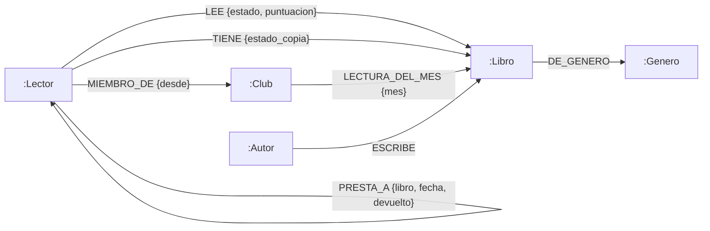
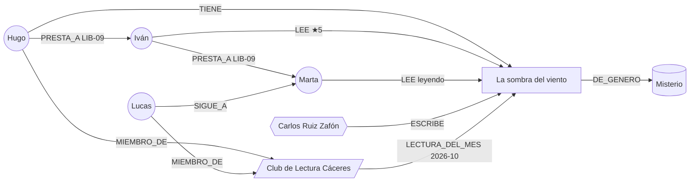

# Modelo del grafo · PasaPágina

## 1. Diagrama

### 1.1 Esquema general (etiquetas y relaciones)

### 1.2 Un trozo del grafo con mis datos

Aquí se ve la gracia del grafo: la cadena de préstamo (Hugo → Iván → Marta), y que a Lucas le toca leer ese libro en su club y Hugo, que es del mismo club, lo tiene en casa.

## 2. Nodos y sus propiedades

Las marcadas como obligatorias son las que sin ellas el nodo no tiene sentido. El `id` además tiene restricción de unicidad.

| Etiqueta | Propiedad | Tipo | Obligatoria | Para qué |
|---|---|---|---|---|
| `:Lector` | `id` | String | ✅ única | `LEC-01` |
| | `nombre` | String | ✅ | Nombre de usuario |
| | `email` | String | ✅ | Dato personal, la app no lo puede leer (ver permisos) |
| | `ciudad` | String | | Para quedar en persona a prestar libros |
| | `perfil_privado` | Boolean | | Si es true, no se enseña lo que lee (RGPD) |
| `:Libro` | `id` | String | ✅ única | `LIB-01` (en real sería el ISBN) |
| | `titulo` | String | ✅ | Tiene índice para el buscador |
| | `anio` | Integer | | Tiene índice |
| | `paginas` | Integer | | |
| | `veces_prestado` | Integer | | Contador, se crea con el primer préstamo nuevo |
| `:Autor` | `id` | String | ✅ única | `AUT-01` |
| | `nombre` | String | ✅ | Tiene índice |
| | `pais` | String | | Código de país |
| `:Genero` | `id` | String | ✅ única | `GEN-01` |
| | `nombre` | String | ✅ | |
| `:Club` | `id` | String | ✅ única | `CLU-01` |
| | `nombre` | String | ✅ | |
| | `online` | Boolean | ✅ | Si es online no tiene ciudad |
| | `ciudad` | String | | Solo los presenciales |

## 3. Relaciones

| Relación | Dirección | Propiedades | Qué significa |
|---|---|---|---|
| `ESCRIBE` | Autor → Libro | — | Quién ha escrito el libro |
| `DE_GENERO` | Libro → Genero | — | Género del libro |
| `LEE` | Lector → Libro | `estado` ("leido", "leyendo"), `puntuacion` (1-5) | Lo que ha leído y la nota que le pone |
| `TIENE` | Lector → Libro | `estado_copia` | Tiene el libro físico en casa y lo puede prestar |
| `SIGUE_A` | Lector → Lector | `desde` (Date) | Red social |
| `PRESTA_A` | Lector → Lector | `libro` (id), `fecha` (Date), `devuelto` (Boolean) | Un préstamo. Si se encadenan salen las cadenas de préstamo |
| `MIEMBRO_DE` | Lector → Club | `desde` (Date) | Pertenece al club |
| `LECTURA_DEL_MES` | Club → Libro | `mes` ("2026-10") | El libro que toca leer en el club ese mes |

La nota y el estado van **en la relación `LEE`** porque no son ni del lector ni del libro, son de ese lector con ese libro. En SQL esto sería una tabla intermedia `lecturas`, aquí lo guarda la propia flecha.

## 4. ¿Por qué esto es nodo y esto propiedad?

| Cosa | Lo hago… | Por qué |
|---|---|---|
| **Autor** | Nodo | Un autor tiene muchos libros. Si fuera un texto dentro del libro no podría sacar "otros libros del mismo autor" ni recomendar autores (P2b). Además evito tener "G. G. Márquez" y "García Márquez" como si fueran distintos. |
| **Género** | Nodo | Lo comparten muchos libros y así está escrito igual siempre. Sirve para filtrar y para las estadísticas del analista. |
| **Club** | Nodo | Tiene sus propios datos (online o no, ciudad), sus miembros y su lectura del mes. |
| **Préstamo** | Relación `PRESTA_A` | Va de una persona a otra, así que lo natural es una flecha entre lectores. Así las cadenas se recorren con `PRESTA_A*1..5`. Guardo el id del libro dentro. Lo pensé como nodo `:Prestamo` pero la cadena quedaba el doble de larga y más difícil de consultar. |
| Ejemplar en casa | Relación `TIENE` | Une lector y libro, y lleva el estado de la copia |
| Título, páginas, año | Propiedad | Solo describen el libro, nadie navega por "número de páginas". |
| Ciudad del lector | Propiedad | Solo la uso para mostrarla. Si quisiera "lectores de mi ciudad" para quedar, se podría pasar a nodo `:Ciudad`. |
| Nota, estado | Propiedad de la relación | Son del vínculo lector-libro |

## 5. Identificadores y tipos de datos

- Uso ids **legibles con prefijo**: `LEC-`, `LIB-`, `AUT-`, `GEN-`, `CLU-`. Se leen fácil en las capturas y son los que uso en todos los `MERGE`.
- **No uso el id interno de Neo4j** (`<id>` / `elementId`) porque Neo4j lo puede reutilizar si borras nodos.
- En una app real el id del libro sería el **ISBN**, que ya es único en el mundo.
- Tipos que uso: `String`, `Integer` (páginas, nota, año), `Boolean` (devuelto, online) y `Date` (`date("2026-02-01")`) para las fechas, que así se pueden comparar y ordenar (con texto no se podría hacer bien).

## 6. Límites del modelo

### 6.1 Supernodos

Un supernodo es un nodo con muchísimas relaciones. Aquí los que pueden serlo:

- **Géneros** como "Fantasía" o "Romántica", con cientos de miles de libros.
- **Libros muy famosos** (Harry Potter tendría millones de `LEE`).
- **Clubes enormes** online.

Qué hago para que no pete:

1. **Las consultas nunca empiezan en el género ni en un libro famoso.** Empiezan en un lector o en un autor concreto (que se encuentra con índice), y el género solo lo uso como filtro.
2. **Los saltos están acotados**: `PRESTA_A*1..5`, `SIGUE_A|PRESTA_A*..6`. Nunca pongo `*` sin límite.
3. En la recomendación por afinidad (P2) solo cuento lectores con libros **en común puntuados con 4 o más**, así no se recorre todo el mundo que ha leído un libro famoso.
4. Si un género crece mucho, se puede partir en subgéneros (Fantasía → Fantasía épica, Fantasía urbana…).

### 6.2 Cosas que no conviene hacer en este grafo

- `MATCH (n) RETURN n` o consultas sin nodo de inicio en producción: recorre todo.
- Caminos sin límite (`-[*]-`), porque los caminos posibles crecen muchísimo.
- Sumas sobre todo el grafo (ej. páginas leídas por todos los usuarios en el año): eso mejor en una base de datos de análisis.
- Guardar las portadas o los PDFs dentro del grafo: se guarda solo la URL.
